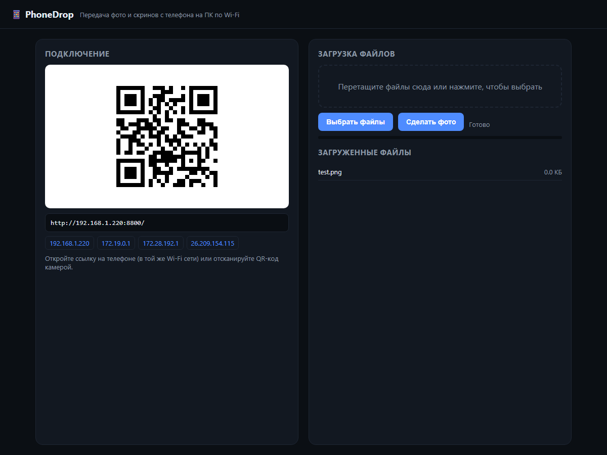

# PhoneDrop

Локальная передача фото, скриншотов и других файлов с телефона на ПК по Wi-Fi.
Запускаете на компьютере — на телефоне открываете страницу, выбираете файлы
или делаете фото камерой, они сохраняются в папку на диске.

Без облака, без аккаунтов, без интернета. Только Python из стандартной библиотеки.



## Возможности

- Приём файлов с телефона через браузер (drag & drop, выбор файлов, камера).
- QR-код и ссылки для быстрого подключения.
- Сохранение в папки по дате (`2026-10-27/`).
- Автоматическое переименование при совпадении имён.
- Список загруженных файлов с размерами.
- Чистый Python 3.8+, никаких `pip install`.
- QR-код генерируется на сервере (SVG), без внешних сервисов.

## Быстрый старт

```bash
python server.py
```

Откройте в браузере ссылку, которую напечатает программа (или отсканируйте QR).
На телефоне должен быть тот же Wi-Fi.

Параметры:

```bash
python server.py --port 8800 --dir "D:\PhoneBackup"
```

- `--port` — порт (по умолчанию 8800).
- `--dir` — папка для сохранения (по умолчанию `~/Pictures/PhoneDrop`).

Windows: можно запустить `run.bat`.

## Требования

- Python 3.8 или новее.
- Телефон и ПК в одной локальной сети.

## Приватность

Все данные остаются на вашем ПК. Никакие файлы и метаданные никуда не отправляются.
QR-код генерируется локально.

## Лицензия

MIT. См. [LICENSE](LICENSE).
